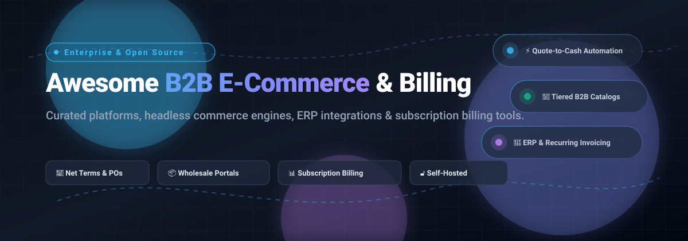

# Awesome B2B E-Commerce & Billing 💼💳

  

  
  
  
  
  
  
  

> 🌟 **A definitive, community-curated directory of top B2B e-commerce platforms, quote-to-cash engines, subscription billing infrastructure, wholesale storefronts, and open-source self-hosted solutions.**

---

## 📌 Table of Contents

- [📈 Sector Overview & Market Dynamics](#-sector-overview--market-dynamics)
- [☁️ SaaS & Hosted Enterprise Platforms](#️-saas--hosted-enterprise-platforms)
- [🔓 Open-Source GitHub Projects](#-open-source-github-projects)
- [💡 Architectural Key Takeaways](#-architectural-key-takeaways)
- [🤝 How to Contribute](#-how-to-contribute)
- [💖 Support & Sponsor](#-support--sponsor)
- [📊 Star History](#-star-history)
- [⚠️ Disclaimer](#️-disclaimer)

---

## 📈 Sector Overview & Market Dynamics

The global B2B e-commerce transactional market represents an estimated **$26 trillion to $36 trillion** volume, with dedicated enterprise B2B commerce software and billing platforms forming a rapidly scaling multi-billion-dollar SaaS and open infrastructure industry.

The sector is **moderately fragmented**:
* **Horizontal Commerce & Payments**: Market leaders like Shopify and Stripe dominate consumer commerce, digital checkouts, and developer billing APIs.
* **Complex Quote-to-Cash & ERPs**: Enterprise wholesale transactions require complex buyer hierarchies, custom price lists, volume-tiered discounts, request-for-quote (RFQ) workflows, and real-time ERP integration (SAP, Microsoft Dynamics, NetSuite)—fostering specialized platforms such as OroCommerce and Sana Commerce.
* **Vertical Wholesale & Subscriptions**: Fashion and consumer goods rely on specialized suites like NuORDER and Pepperi, while subscription monetization is spearheaded by engines such as Chargebee and Zuora.

---

## ☁️ SaaS & Hosted Enterprise Platforms

Comprehensive comparison of commercial B2B commerce and billing software, sorted by company valuation and market footprint:

| 🏢 Product | 📊 Company Size / Valuation / Revenue | 💰 Pricing (Starting Tier) | 🎁 Free Tier / Trial Limits | 📝 Description & Best For |
| :--- | :--- | :--- | :--- | :--- |
| **[Shopify Plus](https://www.shopify.com/plus)** | ~$215B Market Cap (~$12B TTM Revenue) | Starts at **$2,300/month** (3-yr term) or $2,500/month (1-yr term) | **No permanent free tier**; 3-day standard trial applies to regular plans only (targeted 30-day merchant pilots available upon invitation) | Enterprise commerce platform with native B2B capabilities including company profiles, custom price lists, and unlimited B2B catalogs. Best for high-growth mid-market to enterprise merchants. |
| **[Stripe Billing](https://stripe.com/billing)** | ~$159B Private Valuation (~$6.8B ARR) | Starts at **0.7% per recurring transaction** (pay-as-you-go; 0.4% per paid invoice for one-off billing) | **No permanent free tier** for live billing volume; **unlimited free testing** in Stripe Test Mode / Sandboxes (up to 5 isolated sandboxes) | Subscription and recurring billing infrastructure handling automated invoicing, prorations, and revenue management. Best for developer-first SaaS and subscription platforms. |
| **[HubSpot Commerce Hub](https://www.hubspot.com/products/commerce)** | ~$12B Market Cap (~$3.1B ARR) | Starts at **$85/seat/month** (Professional tier, billed annually) + 2.9% + 0.5% platform fee | **Forever Free Tier available** (limited to basic one-off invoices, payment links, and up to 2 CRM users; excludes advanced quotes & subscriptions) | CPQ, quoting, invoicing, and payment links natively embedded inside the HubSpot CRM ecosystem. Best for sales-driven teams wanting quote-to-cash without a separate storefront. |
| **[Chargebee](https://www.chargebee.com/)** | ~$3.5B Private Valuation (~$250M ARR) | Starts at **$0/month** (Starter Plan) / $599/month (Performance Plan, billed annually) | **Forever Free Tier available** (Starter Plan covers up to **$250,000 in cumulative lifetime billing**; 0.75% overage fee thereafter); 14-day free trial on higher tiers | Subscription management and recurring billing platform supporting complex dunning, tax compliance, and revenue recognition. Best for fast-growing SaaS and recurring B2B subscriptions. |
| **[Zuora](https://www.zuora.com/)** | ~$1.7B Private Take-Private Value (~$430M ARR) | Starts at approx. **$75,000/year** (custom enterprise contract tiers) | **No permanent free tier**; free developer API sandboxes and guided proof-of-concept trials available upon sales request | Enterprise subscription billing, CPQ, and revenue recognition engine built for complex usage-based pricing models. Best for large enterprises with complex monetization structures. |
| **[NuORDER by Lightspeed](https://www.nuorder.com/)** | ~$425M Acquisition Valuation (~$600M+ Parent Lightspeed Revenue) | Starts at approx. **$7,000/year** (~$600/month, annual commitment) | **No general public free trial**; complimentary retail buyer portal access available strictly for select wholesale retail partner networks | B2B wholesale platform designed for fashion, retail, and lifestyle brands featuring visual digital line sheets and trade order writing. Best for wholesale brands and department store suppliers. |
| **[BigCommerce B2B Edition](https://www.bigcommerce.com/)** | ~$300M Market Cap (~$340M ARR) | Starts at approx. **$1,000/month** base Enterprise + ~$500/month B2B Edition add-on (~$18,000/year) | **15-day free trial** (standard storefront trial with no credit card required; B2B buyer portal features require sales-assisted enterprise demo) | Comprehensive B2B commerce solution integrated into BigCommerce, offering buyer corporate hierarchies, sales rep masquerading, and custom price lists. Best for mid-market merchants. |
| **[Sana Commerce](https://www.sana-commerce.com/)** | ~$50M–$60M ARR (Privately Held) | Custom enterprise quote (starts at approx. **$1,000/month** / $12,000/year for Essential tier) | **No permanent free tier or self-serve free trial**; guided ERP environment compatibility review and personalized demo provided upon request | ERP-integrated B2B e-commerce platform communicating directly with SAP and Microsoft Dynamics in real time. Best for manufacturers and distributors running SAP or Dynamics. |
| **[Pepperi](https://www.pepperi.com/)** | ~$15M–$25M ARR (Privately Held) | Starts at approx. **$500/month** (Pro plan base, user-tiered pricing model) | **No standard web platform free trial**; limited evaluation mode on mobile field app with guided demo required for back-office configuration | Unified B2B commerce combining web storefronts, field sales automation, trade promotion management, and route accounting. Best for consumer goods brands and direct store delivery (DSD). |
| **[OroCommerce](https://oroinc.com/b2b-ecommerce/)** | ~$10M–$20M ARR (Privately Held) | Custom enterprise quote based on GMV bands (Community Edition is $0 open-source) | **No cloud enterprise free trial**; Community Edition is 100% free to self-host without time limits; guided demo available for Enterprise | Enterprise-grade B2B e-commerce platform engineered specifically for complex manufacturing, wholesale, and distributor workflows with multi-org hierarchies and RFQ processes. |

---

## 🔓 Open-Source GitHub Projects

Curated list of self-hosted open-source B2B commerce platforms and billing engines, sorted by GitHub Stars_Count:

| 📦 Repository | ⭐ GitHub_Stars | 🎯 Primary Focus | 🛠️ Tech Stack | 📜 License | 🚀 Key B2B & Billing Capabilities |
| :--- | :--- | :--- | :--- | :--- | :--- |
| **[Medusa](https://github.com/medusajs/medusa)** |  | Headless B2B Commerce | Node.js, TypeScript | MIT | Modular digital commerce backend featuring customer groups, tier pricing, multi-currency price lists, and extensible workflows for building custom B2B storefronts. |
| **[Bagisto](https://github.com/bagisto/bagisto)** |  | B2B & Multi-Vendor Commerce | PHP, Laravel, Vue.js | MIT | Feature-rich commerce engine with native B2B marketplace tools, request-for-quote (RFQ) modules, customer group pricing, and multi-currency/multi-inventory support. |
| **[Saleor](https://github.com/saleor/saleor)** |  | Headless GraphQL Commerce | Python, Django, GraphQL | BSD-3-Clause | Enterprise headless commerce engine featuring multi-channel orchestration, custom price books, granular permission groups, and webhook-driven ERP integration. |
| **[Spree Commerce](https://github.com/spree/spree)** |  | B2B Wholesale Commerce | Ruby on Rails | AGPL-3.0 | Battle-tested wholesale platform featuring quick-order bulk matrices, custom client price lists, spending limits, and multi-vendor marketplace expansion. |
| **[Invoice Ninja](https://github.com/invoiceninja/invoiceninja)** |  | Invoicing & Subscription Billing | PHP, Laravel, Flutter | Elastic License 2.0 | Complete self-hosted invoice and recurring billing management suite supporting quotes, purchase orders, client customer portals, and 30+ payment gateways. |
| **[Vendure](https://github.com/vendurehq/vendure)** |  | Headless GraphQL Commerce | TypeScript, Node.js | GPLv3 / Commercial | Modern headless framework with plugin architecture, role-based access controls, tiered pricing tables, and configurable checkout pipelines. |
| **[Crater](https://github.com/crater-invoice-inc/crater)** |  | Invoicing & Expense Tracking | PHP, Laravel, Vue.js | Open Source | Clean open-source invoicing software allowing businesses to track expenses, issue professional PDF invoices/estimates, and collect online payments. |
| **[Kill Bill](https://github.com/killbill/killbill)** |  | Open-Source Subscription Billing | Java | Apache-2.0 | Robust billing and payment processing platform supporting real-time catalog management, complex recurring billing cycles, dunning logic, and payment routing. |
| **[Shopware](https://github.com/shopware/shopware)** |  | Enterprise B2B/B2C Commerce | PHP, Symfony, Vue.js | MIT | Modular commerce system with an advanced Rule Builder, B2B Suite module for quote workflows, budget management, sales rep roles, and complex pricing rules. |
| **[GrandNode](https://github.com/grandnode/grandnode2)** |  | .NET B2B E-Commerce | ASP.NET Core, C#, MongoDB | GPL-3.0 | Cross-platform .NET commerce engine with native customer tier pricing, sales employee roles, multi-store/multi-vendor catalogs, and headless REST APIs. |
| **[UniBee](https://github.com/UniBee-Billing/unibee)** |  | SaaS Billing & Subscriptions | Go / Java, Vue | AGPL-3.0 | Universal subscription billing engine engineered as a self-hosted alternative to Chargebee/Stripe Billing, offering plan management, metrics, and automated invoicing. |
| **[OroCommerce Community](https://github.com/oroinc/orocommerce)** |  | Enterprise B2B Commerce | PHP, Symfony | OSL-3.0 | Dedicated open-source B2B platform with robust corporate account structures, multiple shopping lists, custom price books, and RFQ management. |

---

## 💡 Architectural Key Takeaways

* **B2B Commerce Platforms vs. Billing Engines**: 
  * Platforms like **Shopify Plus, BigCommerce B2B, OroCommerce, Sana, Medusa, Bagisto, Saleor, Spree, Vendure, Shopware, and GrandNode** provide storefronts, product catalogs, customer groups, and wholesale ordering.
  * Invoicing and monetization engines like **Stripe Billing, Chargebee, Zuora, Invoice Ninja, Crater, Kill Bill, and UniBee** manage subscription life cycles, meter usage, issue recurring invoices, and process collections.
* **Hybrid Modern Architecture**: Engineering teams frequently pair a headless commerce storefront (e.g., Medusa or Spree) with a dedicated subscription billing engine (e.g., Kill Bill, Invoice Ninja, or UniBee) along with Stripe or Adyen payment rails.

---

## 🤝 How to Contribute

Contributions are warmly welcome! Help keep this directory comprehensive and up-to-date:

1. 🍴 Fork the repository.
2. 📝 Add or edit entries in `README.md` following the tabular format.
3. 🔍 Ensure descriptions are factual, objective, and link directly to official documentation.
4. 🚀 Submit a pull request with a concise summary of changes.

---

## 💖 Support & Sponsor

If you find this curated directory helpful for your architectural research or project implementation, please consider supporting the project:

- ⭐ **Star this repository** to improve visibility for other developers.
- 🍴 **Fork and share** with colleagues, engineers, and e-commerce architects.
- ☕ **Buy a coffee & sponsor**: Support continuous maintenance via the [GitHub Sponsor Dashboard](https://github.com/sponsors/ishandutta2007).

---

## 📊 Star History

---

## ⚠️ Disclaimer

- This is an independent, **community-curated** list intended solely for architectural review and research—not an official commercial endorsement.
- All B2B e-commerce and financial transaction implementations must independently comply with regulatory standards including PCI-DSS, GDPR, CCPA, and regional digital invoice/taxation directives.
- Self-hosted open-source software requires dedicated security audits, infrastructure hardening, and ongoing maintenance.

---

  <b>Built with ❤️ for developers, B2B merchants, and architects engineering modern commerce.</b>

